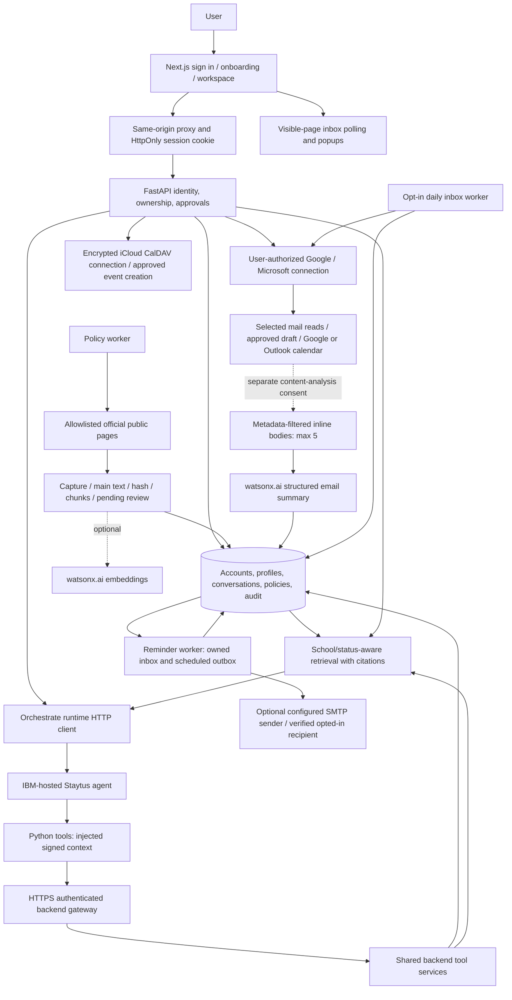

# Current Staytus architecture

This describes current behavior through November8: public Vercel frontend/API/gateway at https://mystaytus.vercel.app, Supabase-hosted PostgreSQL, real IBM Live chat, topic-specific retrieval, personal workflow checklists, opt-in inbox monitoring, separately consented matched-email analysis and calendar adapters. Original plans remain historical. See `DATA_STORAGE_AND_RAG.md` for current storage and data flow and `../infra/vercel/README.md` for release operations.

## User path and frontend

`page.tsx` only chooses authentication, first-use profile setup or the account's workspace. Components render each screen; hooks own abortable request/session state. Switching accounts or logging out tears down previous requests and view state. No sample-persona cards, demo reviewer checkbox or local template answers remain.

The Next.js proxy holds the opaque session token in an HttpOnly cookie, supplies it to the backend and removes it from JSON responses. Mutation origin checks and narrow OAuth callback redirects stay in the proxy. IBM/provider credentials never reach browser storage.

## Identity and business state

`identity.py` handles registration/login/me/onboarding; `auth.py` hashes passwords/session tokens, rotates sessions, checks ownership and issues short-lived tool capabilities. The operator now persists shared state in Supabase Free PostgreSQL17, accessed through the free IPv4 Session pooler with `sslmode=verify-full` and a trusted CA bundle. API and gateway share the limited runtime role; migrations use a separate owner credential. Supabase Data API is disabled and anon/authenticated/service_role have no business-table privileges. Frontend requests still go through the backend identity/ownership checks. Original local PostgreSQL and SQLite remain intact; fresh configurations may still choose SQLite.

`database_migrations.py` and the shipped Alembic revision replace production `create_all`: schema changes run explicitly, and API/gateway refuse an outdated/unversioned database without modifying it. `database_transfer.py` supports readonly SQLite import and a repeatable-read/read-only PostgreSQL snapshot, only into an empty migrated PostgreSQL target. It locks tables, verifies values and commits atomically. Two measured SQLite legacy differences have a narrow, non-destructive compatibility path. Actual Supabase transfer preserved25tables/266rows/98totalchunks. A versioned private application archive was restored into fresh PostgreSQL and compared against the cloud. See `DATABASE_AND_CONTAINERS.md` for operations and boundaries.

`rules.py` uses actual school YAML and user-supplied dates. Internal preparation buffers are labelled as planning preferences. Unknown schools receive federal public information without fabricated school-specific deadlines.

`profile_details.py` validates optional structured business facts persisted in `user_profiles.planning_details` by additive Alembic revision `20261103_0002`. Profile edits merge and validate nested fields before persistence; category changes clear incompatible facts. `business_planning.py` drives stage-specific questions/checklists, explicit record conflicts and internal OPT/EAD/Academic Training targets. Dashboard, existing signed tools and chat grounding share these facts. Current activity is separate from the application being tracked. See `PERSONAL_WORKFLOWS.md` for delivered boundaries and the proposed guided/proactive chat design.

`workflow_guidance.py` supplies category-specific checklists, missing questions, date-conflict signals and source capture/review/freshness metadata to the dashboard, chat grounding and existing `build_action_plan` tool. F-1 OPT/STEM/completion, J-1 student Academic Training and scholar sponsor/department workflows remain distinct. No new legal dates or eligibility decisions are inferred.

`services.py` enforces exact-content approval, expiry, current profile version and one execution. Models may propose actions; final execution remains an authenticated UI operation. Remote previews include a server-derived connected-account target in the hashed payload. Relinking, a stale profile or a legacy unbound approval requires a fresh preview. Atomic claims recheck stored ownership/version/hash rather than trusting a loaded ORM snapshot.

Calendar export creates an Apple-compatible `.ics` with an alarm; separately authorized Google/Outlook and iCloud CalDAV adapters can create one approved event. iCloud uses an encrypted, independently revocable Apple app-specific password, not an assumed Apple OAuth client. Discovery and writing share a30second budget; target selection/relinking invalidates older previews. Email execution creates a provider draft, never sends it. An uncertain provider failure cannot be retried automatically as a successful or fresh action. These remote adapters have mocked/security coverage; actual personal consent and provider-write tests remain pending.

## The one chat path

The frontend renders all assistant replies and restored history through the same Markdown/GFM component, including planning narratives. Tables have a bounded scroll region; headings, nested lists, links and code retain their structure. Bare HTML line-break nodes become safe line breaks, while other raw HTML and unsafe URLs are disabled. Model-provided images are displayed as text without automatic network loads. User messages remain plain text; rendering does not regenerate a reply or change its stored content.

`POST /chat` accepts a message and optional local conversation ID. It resolves the owner from the session and stores the IBM thread ID privately. A browser cannot choose another person's provider thread. The backend retrieves relevant source evidence and calls `OrchestrateRuntime`.

`POST /chat/new` creates an owned empty conversation without calling IBM. The first turn starts a fresh provider thread and receives no turns or temporary planning scenario from the old conversation. `GET /chat/history` also restores explicitly started empty conversations, so a reload cannot resurrect an older topic. Alembic `20261104_0004` persists the per-conversation `hide_assistant_updates` flag; existing chats default false. The previous conversation's bounded history is preserved, not exposed through a new history-management UI. Refresh data reloads saved data without starting or deleting a conversation.

An optional typed `planning_request` drives guided travel/OPT/extension/J-1 forms through this same route. `guided_planning.py` validates the base profile version and temporary overrides, selects workflow checks, retrieves evidence and supplies scenario facts to the real LLM. The profile remains unchanged. `planning_timeline.py` compiles a server-owned core sequence and a private allowlist of contextual candidates derived from real record checks and missing facts. The model may select at most three candidate IDs and explain them; it cannot set their dates, titles, dependencies, sources, placement or calendar actions. The backend validates and inserts accepted candidates, then removes the private catalog before persistence. Server-calculated internal preparation targets accompany the model narrative and feed the existing calendar preview/approval UI. Account-owned conversation JSON retains final plan metadata and citations; `GET /chat/history` restores the latest successful conversation. Follow-ups retain the scenario while its profile version is current. These forms do not add proactive generation, arbitrary workflow invention, legal-date calculations or automatic calendar writes.

Cloud requests use the service-instance URL plus `/v1/orchestrate/{agent_id}/chat/completions`, `stream:false`, and the `X-IBM-THREAD-ID` header on subsequent turns. The signed `staytus_context` is resent in the separate request `context` dictionary on every turn; it is never included in model messages. Python tools read it from `AgentRun.request_context` and send it with the independent tool-service key to the backend. The gateway validates both and resolves the account/profile itself.

Missing configuration or tenant-context validation produces503. Provider failures produce502 without a keyword fallback. MockTransport tests verify the real adapter/request path. Actual isolated Draft/Live probes and the published main Agent passed two-account profile/audit isolation; a separate Next.js proxy-to-Live-to-tool smoke returned200, and visual browser chat produced the expected owned profile and audit. Four bounded Live business cases exercised all13tools with17invocations. Mailbox permission denial and exact unexecuted proposals count as the intended safe results, not as actual mail/calendar writes. A subsequent proposal-only Live recheck passed after target-binding hardening. The private local gate is enabled after those checks; defaults remain false. New deployments/configuration changes require their own matching evidence.

Tenant testing found that tool context propagation requires `context_access_enabled: true` while `context_variables: []` keeps the model allowlist empty. No capability is declared or interpolated into a model prompt. The thin Python wrapper uses standard-library HTTPS, verified TLS, no redirects/retries and bounded time/response size; it needs no extra runtime package beyond the SDK supplied by the importer.

## Capture and RAG

The source registry loads YAML. The worker fetches enabled official URLs, checks robots/public IPs, constrains redirects/size/time, extracts main text, versions changes and indexes actual chunks. Source status records attempts, success and safe failure states. Fetches never create an effective legal rule.

Retrieval filters fixtures, school and category. Pending snapshots are usable as explicitly unreviewed information; reviewed/current rule authority remains separate. Optional watsonx.ai embeddings improve retrieval when configured. Without them the system reports keyword retrieval. See `POLICY_PIPELINE.md` for measured outcomes.

`retrieve_for_profile()` now supplies chat grounding, policy search and the Orchestrate tool through the same provider factory. Generation-only policy comparison is independent of embedding configuration. Chinese keyword queries do not silently match the entire English corpus. Model defaults remain blank until the actual regional catalog and inference entitlement are checked. Operator scripts support catalog discovery, a bounded English/Chinese relevance check, and reindexing existing captures without changing their capture dates or review state.

The local server configuration now selects catalog-verified IBM Granite models. Actual embedding and structured-generation probes passed, and the November3 expansion indexed87current chunks from15successful sources at768dimensions, out of23registered topics. Eight sources still return403. The exact selected embedding model uses its documented512token input truncation; full stored texts and citations remain intact. A fixed Chinese query returned real hybrid matches and citation/review metadata. Policy comparison uses watsonx.ai `/ml/v1/text/chat` with strict JSON parsing; it does not replace the Orchestrate chat model. This small corpus/probe establishes connectivity and indexing, not comprehensive policy coverage or general answer quality.

## Email and permissions

OAuth is separate from signing into Staytus. Users choose Google/Microsoft; mail reads, draft creation and calendar writes have separate capabilities and consent. Calendar-only linking does not imply mail access. Callback returns through the same-origin proxy and matches the original login session plus one-use PKCE state. Tokens and provider-confirmed mailbox identity are encrypted on the server. Reads select recent official-topic messages; mailbox bodies are not silently sent to a model.

UI reads and `read_recent_official_messages` share one account-scoped service. Cloud Agent preview access is separately disabled by default and resets on relinking/disconnection. With user permission, a requested preview tool read returns at most10short previews, marked untrusted; mail is not added to the policy corpus.

Full-content analysis has another independent, default-off consent. `mail_analysis.py` first uses the existing sender/topic metadata filter, then fetches only bounded inline text for at most5matched messages; attachments are excluded. The raw body exists only in memory for the request and is supplied as untrusted data to a strict watsonx.ai structured-summary call. Output validation binds each result to the supplied message and requires every normalized action date to be grounded in an exact quote from that body. Neither the browser nor Orchestrate receives raw body text. `mail_analysis_models.py` persists only an encrypted summary payload and a hashed message identity; results expire and are physically deleted after90days, and disabling consent immediately deletes that provider's saved summaries. Relinking, profile changes and mid-request permission changes invalidate cached or in-flight results. Mocked provider/model security coverage and one real owner-consented matching Gmail summary passed; no Outlook mailbox has completed this flow. Connections shows the consent boundary, exact redirect URLs and non-secret developer registration requirements. See `EMAIL_CONNECTIONS.md`.

## Continuous reminders

`assistant_updates.py` consumes eligible existing reminder events through the separate daily `/internal/jobs/assistant` job. `assistant_update_models.py` persists account-owned generation batches and unique event reservations, added by Alembic `20261104_0003`. A bounded text-only watsonx.ai generation call uses structured profile facts, RAG/source evidence and preparation targets. It needs no login session or Orchestrate tool capability. Normal interactive chat remains Orchestrate; background messages use the already configured watsonx.ai generation model. Claims/retry limits and fresh-input checks prevent duplicate or stale publication. Successful messages are returned separately by the owned assistant-updates API, displayed inside the chat area and supplied as follow-up context. EN/ZH, on/off and read settings persist. No user question is fabricated, and no background message executes an action. See `PROACTIVE_ASSISTANT.md` for scope, limits and verification.

`notification_models.py` adds account-owned preferences, notices, delivery records and item reservations. `notifications.py` turns deterministic planning targets and relevant source updates into deduplicated notices. Captured source updates keep their pending-review status. Changed dates supersede old notices. The UI bell polls while the page is visible, tracks unread/pop-up acknowledgements and supports daily/weekly/monthly/off preferences in the selected timezone.

The reminder worker shares the application lifespan stop event. Optional Brevo HTTPS / SMTP digests require operator sender configuration plus explicit user consent bound to a provider-verified recipient and connection ID; they default off. Relinking, revocation or a changed profile cancels unsent snapshots. Before sending, the worker rechecks current recipient, consent and content. Only definite safe rejection can retry within a bound; uncertain/interrupted sends are retained for reconciliation. SMTP is independent of Gmail/Graph draft scopes. The current account has enabled daily monitoring and email subscription; real owner-requested Brevo HTTPS and later SMTP tests reached Gmail in SPAM. Production now selects SMTP with the original key after the user disabled its IP blocking; the HTTPS key remains an unselected alternative. Natural scheduled digest delivery remains to be observed. These are in-app popups, not OS/background device push. See `REMINDERS_AND_CALENDARS.md`.

## Read-only scheduled mailbox monitoring

`mail_monitor_models.py` stores an independent, default-off background-read consent and hashed message IDs. `mail_monitor.py` adds per-provider schedule/manual-check APIs and a lifespan worker; root-owned session context controls ownership. The daily check uses the current verified read connection, bounded30day INBOX queries and at most20matching messages. Manual checks have a5minute cooldown. Relinking or revocation invalidates recurring consent. A fresh-state check after the provider read discards results if authorization changed. Without the separate content-analysis consent, only generic private count notices and dedup fingerprints persist and no body reaches a model. When both consents remain current, only up to5new metadata-filtered matches enter the bounded in-memory body/summary path described above; raw bodies and attachments are not retained, and only encrypted90-day summaries persist. Partial batches remain eligible for a later run instead of being marked fully processed. This is not provider delta synchronization or a complete mailbox archive. The mailbox monitor adds no send/mark-read/delete behavior. Separate opt-in system reminders now use Brevo SMTP; HTTPS API remains an explicitly selected alternative.

## Separate tool deployment

The narrow `app.tool_gateway:app` source exposes only health and14authenticated tool operations, sharing the main API database and explicit signing/service secrets. The fourteenth operation returns validated matched-email summaries after the separate content-analysis consent; it never returns raw bodies. The gateway exposes no login, OAuth callback or final approval execution routes. An authorized public HTTPS edge targets that gateway while the app stays private. All14wrappers are imported, bound and published; updated-artifact Draft/Live and main-Agent two-account tests passed, and a separate Live case verified that both mail tools deny a synthetic account without their required permissions. These cloud checks establish routing, identity isolation and denial behavior, not real mailbox-body access or comprehensive answer quality. See `ORCHESTRATE_SETUP.md` for staged validation and deployment.

No private Penn portal permission is inferred from a school name, email address or general browser access. This integration remains unavailable until an authorized interface exists.

## Remaining gates

Vercel production now uses one project with three Services: public Next.js `web`, private FastAPI `api` reached through a server-only `BACKEND_URL` binding, and a narrow public `gateway`. Top-level routing exposes `/tools/*` and `/health` to the gateway, authenticated `/internal/jobs/*` to the API, and the remaining paths to Next.js. Direct main-API paths remain unavailable from the public edge. Cloud entrypoints retain verify-full database TLS with a packaged public CA, disable lifespan threads and use nonpersistent connection pooling. All26daily jobs, including proactive assistant generation, are registered and enabled, with a separate cron secret and PostgreSQL transaction advisory locks. Manual authenticated dispatch passed for policy, reminders and mailbox jobs; scoped proactive generation also passed without an active login. Hobby scheduling is daily and can be delayed within an hour; it does not provide minute-level scheduling. Two synthetic public users passed onboarding, hybrid retrieval, IBM chat/audit and cross-account denial checks; actual browser chat also passed. Public identity recovery/shared rate limiting and broader OAuth verification remain separate release work.

- The current source and published Agent have14tools. Updated-artifact Draft/Live and main-Agent two-account checks cover identity/audit routing, and the new summary tool has explicit Live permission-denial coverage. Real mailbox-body analysis and arbitrary workflow/answer quality are not established by those cases. Draft and Live use the stable public Vercel gateway with the existing keys; the temporary local tunnel has been retired.
- Actual approved calendar writes and later public-app verification. Google project staytus-513614 has the production callback, Gmail/Calendar APIs, minimum read/owned-calendar scopes and designated test user; External/Testing status remains. Public pre-consent security probes, personal Gmail/Calendar grants, a real metadata inbox check, one matching-body summary and a field-limited Calendar API200 probe passed. An offline refresh credential is present and the current consenting account has daily background reads enabled. No real event write is claimed. The Microsoft application is configured in the developer's personal directory for organizational and personal accounts, but the Penn-managed mailbox requires administrator approval and no eligible personal Outlook mailbox has completed consent/read testing.
- Permitted resolution of Penn public-source403, and separate private-portal authorization.
- First natural scheduled-email validation and improved inbox placement after the successful Brevo test (currently SPAM); device background push and school-application submission remain unimplemented. iCloud code and approved-write mocks are implemented, but an actual Apple account still needs testing.
- Production identity controls (verified email, recovery and shared login-rate limits), retention/deletion, monitoring and broader answer-quality evaluation remain. Supabase PostgreSQL/TLS, backup restore, local container builds and public Vercel deployment are verified. Web/API/gateway and daily scheduling no longer require this computer to remain awake. Vercel/Supabase free-tier limits and IBM course/trial service entitlements still apply.

See [Brevo system emails](BREVO_EMAIL.md) for the selected transport, restricted resource permissions, provider-acceptance boundary and current-account verification.
