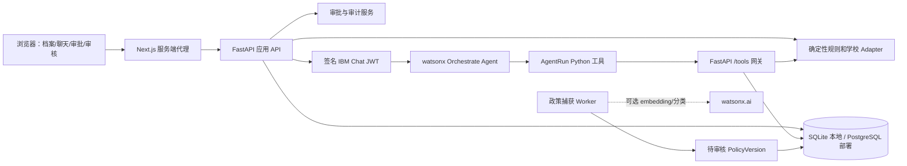

# Staytus 代码架构与阅读指南

> 历史说明：下面记录最初的本地原型。2026年11月1日已迁移到真实账号、独立组件、官方网页抓取和单一 Orchestrate REST 聊天路径；旧 demo 和独立嵌入聊天已撤出产品。当前实现以 [ARCHITECTURE.md](ARCHITECTURE.md)、[FEATURES.md](../FEATURES.md) 和 [CHANGELOG.md](../CHANGELOG.md) 为准。

这份文档解释已经写入仓库的代码。原来的 `UNIFIED_PROJECT_PLAN.md` 保留为规划依据；实现中的调整记录在 `IMPLEMENTATION_DECISIONS.md`。

## 1. 现在实际可以运行什么

`make dev` 启动两个进程：Next.js 页面运行在 3000，FastAPI API 运行在 8000。首次启动自动创建本地 SQLite 数据库，放入三份模拟学生/学者档案、演示政策文本和初始提醒规则。

你可以切换 F-1、J-1 student、J-1 scholar，修改日期、查看提醒计算过程、聊天生成操作预览、批准操作、下载真实可导入日历的 `.ics` 文件、查看审计记录。审核员还可以触发虚构的“内部准备缓冲期变化”，审核后重算三份档案的提醒。

本地聊天目前是明确标注的确定性演示驱动器。它调用真实的后端服务，便于不依赖外部 API 验证流程。Orchestrate 的模型对话使用另一条已写好的接入路径，需要课程 tenant 的 Agent、连接、签名密钥和上下文验证通过后开启。页面没有把本地回复冒充 IBM 模型回复。

## 2. 各部分怎样连接

Next.js 和 FastAPI 可以部署在不同服务上。IBM Cloud 是部署与服务账号的管理平台；Code Engine 可以运行 FastAPI 和 worker。Orchestrate 管理 Agent、模型和工具调用。watsonx.ai 给后台提供 embedding/分类等模型 API。使用 Orchestrate 不会自动替你存好学生档案，也不会自动形成我们的审批和规则数据库。

## 3. 前端：用户看见什么

`frontend/app/page.tsx` 是第一版主界面，按当前 tab 渲染九类功能：Overview、Assistant、Policy library、Approvals、Policy updates、Profile、Review workspace、Activity log、Connections。第一版使用一个页面内的导航状态，后续可以拆成独立 App Router 路由和组件。

`frontend/lib/api-client.ts` 统一 HTTP 请求、JSON 和错误提示，页面不用到处手写 fetch 的错误处理。

`frontend/app/api/backend/[...path]/route.ts` 是服务端代理。浏览器请求 `/api/backend/dashboard`，代理再调用 FastAPI `/api/v1/dashboard`。登录取得的后端 session token 保存到 HttpOnly cookie，浏览器 JavaScript 读不到它。对写请求检查 Origin，避免另一个网站借用 cookie 触发操作。Logout 同时撤销后端 session。

`frontend/components/OrchestrateEmbed.tsx` 只在用户点击 Open IBM agent 时请求签名配置，并加载官方 `wxoLoader.js`。连接配置缺失时返回明确错误。五分钟 token 到期后需要重新连接；自动续签和 SDK teardown 是后续改善项。

`frontend/app/globals.css` 定义响应式布局、字体回退、按钮、卡片、状态、审批弹窗和窄屏导航。审批弹窗带键盘焦点管理。UI 已做基础可访问性处理，但没有把它宣称为完整 WCAG 审计通过。

## 4. 后端：应用入口与数据库

`backend/app/main.py` 创建 FastAPI 应用，注册应用 API、Orchestrate 工具和 IBM 集成路由。启动生命周期创建新数据库结构并填充模拟数据；中间件生成 request correlation ID，同时在响应中返回该 ID。

`config.py` 读取环境配置。`db.py` 建立 SQLAlchemy engine 和每次请求的数据库 session。一个请求成功后提交事务，异常则回滚。

`models.py` 中的数据表对应产品状态：

| 表/模型 | 为什么需要 |
| --- | --- |
| Profile | 用户明确输入的档案与版本号 |
| AuthSession | 哈希后的随机 session token、所属档案、角色、过期时间 |
| PolicySource | 官方来源登记、允许的主机、抓取开关 |
| PolicyVersion / PolicyChunk | 文本快照、版本、状态、审核信息、可选向量 |
| RuleVersion | 经审核的可执行规则版本与生效时间 |
| DeadlineResult | 某档案版本 + 某规则版本的计算结果 |
| Approval | 待执行内容、SHA-256、过期时间、档案版本和状态 |
| Review | 变化提议及人工审核结果 |
| Notification | 用户受到的变化影响 |
| AuditEvent | 用户范围内的操作轨迹与 correlation ID |
| FetchAttempt | 来源捕获成功/失败记录 |

SQLite 帮我们不用安装 Docker 就能跑起来。PostgreSQL 模式使用同一套模型与 psycopg。`PolicyChunk.vector` 支持 pgvector 类型；当前应用搜索默认用关键词，独立 `retrieval.py` 提供小型语料的可选关键词 + embedding 混合排序。大规模数据库向量索引与线上查询优化尚未实测。

## 5. 确定性规则与学校 Adapter

`rules.py` 定义 SchoolAdapter 接口及 PennAdapter。输入是 Profile 和当前生效的 RuleVersion，输出是带来源引用、rule version、profile version 和 trace 的提醒列表。

例如模拟档案的 program_end 是 2027-05-15，内部准备缓冲期是 60 天，代码用日期减法得到准备提醒。这 60 天是 Staytus 的内部规划偏好，不代表政府或 Penn 的法定截止日期。

我们没有把 Unified Plan 示例里“OPT 从 90 天变 120 天”写成真实规则。实际 OPT、旅行签字有效性、J-1 不同类别资格等，需要逐条核对权威规则并建立经审核测试集后才能启用。

`services.py` 的 active_rule 只选择已经生效的规则，未来版本不会立即接管提醒。计算结果保存到 DeadlineResult，便于以后回答“为什么我的日期变了”。

其他学校扩展时可以新增 Adapter 和配置；不会把所有大学混进同一个 Prompt。当前代码只开放 Penn Adapter，未支持的学校不会自动套用 Penn 流程。

## 6. 审批为什么要经过多个状态

用户说“帮我建一个日历提醒”时，后端先调用 propose，保存完整内容，计算 SHA-256，记录有效期和当前 profile version。此时状态是 PROPOSED。

用户点 Inspect 后，preview 将它置为 PREVIEWED；页面显示原文。用户点 Approve exact action 后，后端检查：

1. 这条审批属于当前登录档案。
2. 状态是 PREVIEWED，尚未使用且未过期。
3. 页面确认的 hash 与保存内容一致。
4. 档案版本没有在预览后变化。
5. 用数据库条件更新原子地领取执行权。

符合条件后执行并写 receipt。重复批准、改动内容、换用户或旧版本审批都会被拒绝。日历/邮件/学校申请目前执行模拟 connector；profile_update 则会实际修改本地档案。`.ics` 下载只有批准后才开放。

最终批准 API 属于用户界面，不在 Orchestrate 导出的工具列表中。模型能提议，不能替用户点击批准。

## 7. Agent 工具网关怎样识别“这是哪个用户”

`auth.py` 区分应用会话和工具会话。应用会话是随机 opaque token，数据库只存 hash。工具调用必须同时拥有服务级 X-Tool-Key 和短期 X-Staytus-Context。

后者由后端根据已登录 session 签名生成，内含 session ID 与 expiry。工具参数中不能传 user_id/profile_id 来决定身份，Pydantic 对额外字段会拒绝。

`integrations/routes.py` 从已经认证的用户 session 生成 RS256 Chat JWT，把短期能力放入 JWT 的 context.staytus_context。IBM 配置好对应公钥后验证 JWT。`orchestrate/python_tools.py` 从 AgentRun.request_context 读取这个能力，加入后端调用的 header，并从 Orchestrate connection 取服务 key。

这条链路的实际租户传递行为必须测试；缺少其中一项时 /tools 返回 401。单独拿到 service key，或者在聊天里输入另一个人的名字，都不能改变后端身份。

生产 OIDC 登录还没有接入。DEMO_MODE=false 时不允许新建 demo session 或使用 demo 工具上下文。这是明确的生产接入边界。

## 8. 政策读取、变化检测和审核

`ingestion.py` 只读取管理员已登记并允许捕获的 HTTPS 来源，限制主机、大小、内容类型和重定向。默认来源开关关闭，需要先完成来源使用条款和策略复核。抓到文本后正规化并计算 SHA-256；变化会创建 detected_pending_review 的候选版本，不自动修改 RuleVersion。

`integrations/watsonx.py` 包含真实 HTTP 请求实现：用 IBM IAM 获取短期 token，调用 watsonx.ai embedding 或文本分类接口，校验返回结构。分类永远是建议，不能自行变成“已经生效”的规则。当前测试使用 HTTP mock，尚未使用课程凭证发出真实模型请求。

`scripts/ingest_sources.py` 提供手动 worker 入口。定时部署时可由 cron、Code Engine job 或 scheduler 调用。当前没有安装任何定时任务。

UI 的 replay 单独模拟内部准备缓冲期改变。reviewer 审核后，新 RuleVersion 被创建，原规则仍保留；三份档案重算并收到 old/new 通知。这个流程证明变化与用户影响之间的数据链可以跑通。把任意真实政策转成可执行法律规则的通用审核编辑器尚未实现。

## 9. OpenAPI 与部署

FastAPI 自动文档适合应用 API；`orchestrate/tools/openapi.yaml` 另存真实 3.0.3 工具合同。`scripts/export_openapi_3_0.py --check` 会检查格式、路径、operationId 和请求字段是否与后端一致，拒绝把 3.1 直接改一个版本号冒充 3.0。

`backend/Dockerfile` 用于后端容器。`compose.yaml` 用于可选本地 PostgreSQL。`.github/workflows/ci.yaml` 提供 GitHub Actions 验证。`infra/code-engine/README.md` 给出 IBM 部署次序；没有创建收费资源，也没有声称应用已经部署到云上。

## 10. 建议阅读顺序

先运行应用，然后依次读：

1. `api.py` 的 dashboard/chat/approvals 路由，观察页面请求怎样进入服务。
2. `models.py`，理解需要保存的状态。
3. `rules.py`，看纯代码怎样从档案和规则得到日期。
4. `services.py` 的 propose/preview/execute/approve_review，理解两条演示流程。
5. `auth.py` 和 `tools.py`，理解权限如何独立于模型执行。
6. `integrations/`、`orchestrate/`，理解 IBM 的接入位置。
7. `backend/tests/`，看系统如何证明不会错误地跨用户或重复执行。

后续最有价值的 IBM Bob 任务是：评审这些已实现模块并修复发现的问题；完成 S1–S3 的真实 tenant 验证；再在 Bob 中实现一个确有价值的 feature，保留 task-session evidence。
