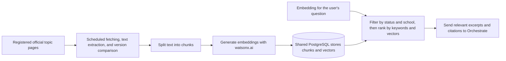

# Data Storage and RAG (2026-11-03)

This document describes the storage and retrieval design at the time of the Supabase migration. See the [Vercel operations guide](../infra/vercel/README.md) for the later public deployment and the [policy pipeline guide](POLICY_PIPELINE.md) for source configuration and scheduling.

The application database was migrated to **PostgreSQL 17 managed by Supabase Free in the US East region**. The main backend and tool gateway shared a private `DATABASE_URL` and connected through the free IPv4 Session pooler with certificate and hostname verification. The migration committed 25 application tables, 266 records, and 98 total policy chunks after field-by-field verification. We also restored the cloud application backup into a fresh local PostgreSQL database and verified the result. After the migration, the cloud database held the active data, while the web app, API, gateway, and background jobs still ran locally at that stage. See the [database migration and container guide](DATABASE_AND_CONTAINERS.md).

The original local PostgreSQL 18.6 instance (`127.0.0.1:55432`, `.local/postgres/data/`) and `backend/staytus-app.db` were retained as pre-migration copies and potential rollback sources. They do not sync automatically with the cloud. Fresh installations can still choose SQLite. The Supabase Data API was disabled, and database credentials stayed on the server.

| Data | Where it is stored |
| --- | --- |
| Official sources and check schedules | `config/sources.yaml` and `policy_sources` |
| Source text, hashes, previous versions, and review status | `policy_versions` |
| Capture time, final URL, success or failure, and indexing status | `policy_snapshot_metadata`, `source_capture_state`, and capture logs |
| Text chunks, parent versions, embedding vectors, and model names | `policy_chunks` |
| User accounts, profile dates and status, and conversations | Separate tables such as `accounts` and `user_profiles`, with ownership checks per user |
| OAuth tokens and iCloud app-specific credentials | Encrypted fields in `provider_connections` |
| Scheduled mailbox checks | `mail_monitor_preferences`, `mail_monitor_seen`, and private reminders. At this stage, the monitoring workflow stored only consent, schedule settings, message ID hashes, and generic count notices. |

These tables are logically separate within one PostgreSQL database. Access is governed by backend ownership checks. Email bodies, attachments, and subject lines or previews from scheduled checks stay out of the public policy index. Short previews from a manual check are visible only to the user who requested it. The chat assistant needs separate permission to read those previews.

## RAG Data Flow

The system writes the numeric embedding arrays to `policy_chunks.embedding`, using the pgvector `vector` type in PostgreSQL. The migration preserved 98 total chunks, including historical versions. The earlier count of 87 covered active chunks only. The backend computed cosine similarity and keyword scores in the application process at this stage. Moving the data to PostgreSQL did not enable a native vector index. In optional SQLite mode, embeddings use JSON. Storing embeddings does not retrain the model.

watsonx.ai processes public source text to generate embeddings. The required chat context passes through Orchestrate, which also holds the conversation threads used by the agent. Supabase stores application state, policy text, and vectors. IBM provides the model and agent services. Each service is configured separately.

## Expanding and Updating the Policy Corpus

The expansion added dedicated topic pages instead of splitting the existing overview pages into smaller chunks. The source list grew from 6 to 23 and covered OPT, STEM OPT, program extensions, travel and I-94, program completion, and J-1 processes. In the first live check, 15 sources were captured and all 87 active chunks were indexed with 768-dimensional embeddings. Eight sources returned HTTP 403. New snapshots remained pending review so that a capture could not automatically activate a legal rule.

In the local setup at this stage, the background worker scanned for due jobs once a minute. Sources were configured for checks every 6 to 24 hours, with up to six processed per batch and later batches handling the rest. A content hash change triggered a new version, new chunks, and an update notice. The capture time was recorded separately from the policy's publication or effective date. Local scheduling stopped when the computer or backend stopped.

Penn's public pages could be opened in a browser without PennKey, and the backend successfully captured some topic pages. The application displayed the remaining HTTP 403 results as errors. It did not copy browser login tokens, bypass access challenges, or treat failed captures as a reason to ask for private portal access. Private iPenn status checks and application submissions remained outside the integration.

Personal workflows provide checklists, missing information, date conflicts, and source status for F-1 students, J-1 students, and J-1 scholars. They support preparation without determining individual eligibility or authoritative filing deadlines. A visa, a program document, a travel signature, and an I-94 serve different purposes and are not interchangeable.

## Relationship to Cloud Database Hosting

Supabase was chosen as the PostgreSQL host. Staytus kept SQLAlchemy, Psycopg, Alembic, and its existing backend account system. Supabase Auth was not adopted. Setting up Orchestrate or watsonx.ai does not provision the application database. Live checks verified the cloud migration, TLS, the limited runtime role, shared access by the separate API and gateway processes, isolation between two accounts, and recovery from an application-level backup. Stable hosting for the web app, API, gateway, and scheduled jobs was the next step at this stage. Native database vector indexing had not been added.

Local `.env` files, databases, backups, and runtime reports stay out of Git. Encryption of credential fields covers those fields only. Production retention, deletion, and operational procedures still required work at this stage. Real mailbox and iCloud operations require authorization from the relevant account and separate integration checks. An Apple app-specific password is not a granular OAuth permission. Use the app-specific password and keep the primary Apple Account password private.

See also [Supabase](https://supabase.com/docs/guides/database/overview), [IBM PostgreSQL](https://cloud.ibm.com/docs/databases-for-postgresql?topic=databases-for-postgresql-getting-started), and [Apple app-specific passwords](https://support.apple.com/en-us/102654).
