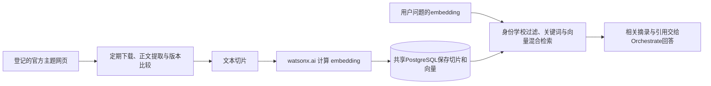

# 数据库与 RAG：当前实现（2026-11-03）

实际运行数据库现已迁移到 **Supabase Free 托管的 PostgreSQL17（美国东部）**。主后端与工具网关根据同一个私有 `DATABASE_URL`，通过免费的 IPv4 Session pooler、证书与主机名验证连接云端。25张业务表、266条记录、98个总政策切片已逐字段校验后提交；云端应用级备份也已恢复到新本机PostgreSQL并校验。数据库不再依赖这台电脑保存唯一副本，但网页、API、网关和后台任务仍在本机运行。见 [迁移与容器记录](DATABASE_AND_CONTAINERS.md)。

原本机PostgreSQL18.6（`127.0.0.1:55432`、`.local/postgres/data/`）以及原 `backend/staytus-app.db` 完整保留，作为迁移前状态和回退来源；它们不会自动与云端双向同步。新安装仍可明确选择SQLite。Supabase Data API未启用，网页不直接使用Supabase数据库密钥。

| 内容 | 当前存储 |
| --- | --- |
| 官方来源、检查计划 | `config/sources.yaml` 和 `policy_sources` |
| 原文、哈希、历史版本、审核状态 | `policy_versions` |
| 抓取时间、最终URL、成功或失败、索引状态 | `policy_snapshot_metadata`、`source_capture_state` 和抓取日志 |
| 文本切片、所属版本、向量数组、模型名称 | `policy_chunks` |
| 用户账户、个人日期与身份、会话 | `accounts`、`user_profiles` 等独立表，按用户校验所有权 |
| OAuth token／iCloud 专用凭证 | `provider_connections` 内的服务器加密字段 |
| 邮箱定期检查 | `mail_monitor_preferences`、`mail_monitor_seen`、私人提醒；仅存授权、时间、消息ID哈希及通用数量通知 |

这些表在同一个PostgreSQL数据库内，逻辑上分开；用户之间的访问仍由后端所有权校验控制。邮箱正文、附件及定期检查中的标题／摘要不进入公共政策库。人工点击检查返回的短预览仅显示在该用户页面；聊天助手读取预览另需单独授权。

## RAG 数据流

向量是数字数组，计算后写回 `policy_chunks.embedding`，并保存在pgvector类型的 `vector` 字段。迁移保留了98个总切片（含历史版本；此前87为当前切片）。当前后端仍在进程中计算余弦相似度和关键词评分，没有自动改成PostgreSQL原生向量索引。可选SQLite模式的vector字段仍用JSON。模型不会因入库而被重新训练。

公开原文用于 IBM 向量计算，必要的聊天上下文和会话线程也会经过／保存在 Orchestrate 云端。Supabase保存业务状态、原文和向量；IBM负责相应的模型／Agent服务，两者是分别配置的云服务。

## 扩充与定期更新

本轮增加具体主题页，而非仅将原来的概览页切得更碎。来源从6增至23，覆盖 OPT、STEM、项目延期、旅行／I-94、毕业安排及 J-1 流程。初次实测15个来源成功，87个当前切片全部完成768维向量索引；8个来源仍403。快照保持待审核，没有自动激活法律规则。

后台每分钟扫描到期任务，来源按6–24小时配置检查，单批最多6个，后续批次处理其他到期来源。内容哈希变化后生成新版本、切片和更新通知；抓取时间与政策发布／生效时间分开。电脑或后端停止后，本机定时任务也停止。

Penn 公开主页在浏览器无需 PennKey，后台也已成功抓取部分主题页。剩余403明确显示，不复制浏览器登录令牌、不绕过挑战，不据此要求学生授权私人门户。iPenn 私人状态与申请提交仍未接入。

个人流程现支持按 F-1、J-1 student、J-1 scholar 展示办理清单、缺失信息、日期冲突和来源状态。尚不是完整移民资格／法定期限引擎；签证、项目文件、旅行签字和 I-94 不能互相替代。

## 与云数据库的关系

本项目已选择Supabase作为PostgreSQL托管商，沿用现有SQLAlchemy/Psycopg、Alembic和后端账号体系，不切换到Supabase Auth。连接Orchestrate／watsonx.ai不会自动创建该业务数据库。云端迁移、TLS、受限角色、独立API/网关共享、双账号隔离和应用级备份恢复已实测。后续要把Web/API/网关及定时任务部署到稳定云端计算环境；数据库原生向量检索索引仍未加入。

本地 `.env`、数据库、备份和运行报告不提交 Git。凭证字段加密不代表整个数据库和备份已加密；生产保留／删除与运维仍需完善。真实邮箱和 iCloud 操作需要相应账号授权及联调；Apple 应用专用密码不是细粒度 OAuth 权限，不可填写 Apple 主密码。

参考：[Supabase](https://supabase.com/docs/guides/database/overview)、[IBM PostgreSQL](https://cloud.ibm.com/docs/databases-for-postgresql?topic=databases-for-postgresql-getting-started)、[Apple 应用专用密码](https://support.apple.com/en-us/102654)。
